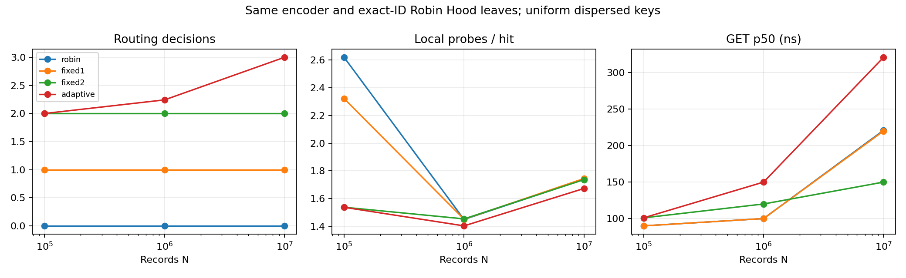

# BDR resolutive addressing: operation counts and scaling

Research report — 2026-10-01. Main audited at `9ab47205cbc09553ecd00a86fd809a7e24d63182`; stable release v1.1.0, published candidate v1.2.0-rc4. Changes confined to `experimental/address_scaling/`. No stable mutation or merge.

## Finding

**A bounded routing path is achievable; it does not bound complete lookup cost.** At 100K/1M/10M, healthy growing Robin Hood leaves maintained small average probe counts despite very different leaf populations. End-to-end throughput nevertheless declined with scale. More subdivisions did not consistently improve that throughput and aggressive adaptive refinement was costly on uniform data. Retaining independent routing entropy helped dramatically under a deliberately weakened fingerprint; destroying both routing and fingerprint entropy defeated the hierarchy.

This supports Result A for normal hashing and Result D for mandatory/aggressive hierarchy in these workloads. There is a narrow conditional C-like result for fingerprint fault injection, but no general new asymptotic class or measured cache-miss advantage (Result B is not established).

The current BDR has several distinct index paths: default Database uses CompactIndex (Robin Hood + byte arena), fallback uses ResolutiveIndex (Robin Hood + strings), and AtomicDatabase's DurableDatabase state uses std::map. The last path is O(log N) tree lookup, not resolutive constant-time hashing. See [AUDIT.md](AUDIT.md) for exact sources and the seven pre-implementation answers.

## Hypothesis and method

Holding encoder and exact-ID Robin Hood implementation constant, ask whether fixed/adaptive address depth changes effective probes, population, latency and memory as N increases. Fixed fanout 64 with 1/2 levels is tested against adaptive threshold256/max3; sensitivity adds fixed3 and thresholds64/1024. These choices are experimentally compared, not assumed optimal. Adaptive splits happen during insertion; existing entries are redistributed and that cost is included.

The suite uses 100K, 1M and 10M unique records; 3 separately constructed processes/query seeds per configuration; 20K exact hit and 20K exact miss checks per row. Independent seeds vary queries, not the population/hash. Latency pass, batch-throughput pass and instrumented operation-count pass are distinct. Fingerprint pressure and total poor-distribution runs stop at 100K because insertion can become quadratic. Every limitation and metric definition is in [README.md](README.md).

Hardware: AMD EPYC 9V74, x86-64 Linux, g++13.3.0, -O3 C++17/pthread; 9 CPUs visible, cgroup quota8 CPUs, memory cap8GiB. Exact kernel, CPU/cache listing, build command and limits are retained in environment.json. Peak process RSS across runs was below 1.85GB. 100M was not attempted: extrapolating full-string native layouts and transient rehash memory would threaten the 8GiB budget. This is single-thread warm-index research, not durable database PUT or cold-disk GET. No perf executable was available, so cache misses/cycles were not measured.

## A — routing; B — local resolution; C — end-to-end GET

Uniform dispersed population; medians across 3 seeded runs. Throughput in million operations/s. Probe counts are measured separately from timing.

| N | Engine | Route decisions | Query-weighted leaf population | Probes/hit | GET Mops/s | p50 ns | p99 ns | RSS MB |
|---:|---|---:|---:|---:|---:|---:|---:|---:|
| 100,000 | robin | 0.00 | 100000.00 | 2.62 | 12.49 | 90.00 | 210.00 | 5.10 |
| 100,000 | fixed1 | 1.00 | 1563.71 | 2.32 | 13.02 | 90.00 | 210.00 | 6.15 |
| 100,000 | fixed2 | 2.00 | 25.41 | 1.54 | 11.89 | 101.00 | 251.00 | 8.40 |
| 100,000 | adaptive | 2.00 | 25.41 | 1.54 | 11.51 | 101.00 | 231.00 | 8.35 |
| 1,000,000 | robin | 0.00 | 1000000.00 | 1.45 | 9.87 | 100.00 | 301.00 | 52.29 |
| 1,000,000 | fixed1 | 1.00 | 15626.03 | 1.45 | 11.85 | 100.00 | 321.00 | 53.65 |
| 1,000,000 | fixed2 | 2.00 | 245.18 | 1.45 | 9.51 | 120.00 | 351.00 | 57.78 |
| 1,000,000 | adaptive | 2.24 | 182.05 | 1.40 | 7.98 | 150.00 | 460.00 | 60.75 |
| 10,000,000 | robin | 0.00 | 10000000.00 | 1.74 | 7.59 | 221.00 | 441.00 | 404.61 |
| 10,000,000 | fixed1 | 1.00 | 156252.18 | 1.74 | 5.67 | 220.00 | 431.00 | 405.72 |
| 10,000,000 | fixed2 | 2.00 | 2442.51 | 1.74 | 5.67 | 150.00 | 441.00 | 439.88 |
| 10,000,000 | adaptive | 3.00 | 39.12 | 1.67 | 3.02 | 321.00 | 731.00 | 538.41 |

With fixed1, query-weighted local population grows from approximately 1,564 to 156,252, while mean probes remain 2.32/1.45/1.74. This is achieved by local table growth and bounded load, **not** by bounding the number of records in the region. Local storage capacity and worst-case resolution can grow even though routing remains one decision. Fixed2 similarly grows from about25 to2,443 records/queried leaf.

Global RH's 100K ->10M throughput declines about39%; adaptive256 declines about74%. Fixed2 p50 at10M is better than global RH in the percentile pass, but batch throughput is worse (5.67 vs7.59 Mops/s) and RSS is higher. Do not select a winner from that p50 alone: batch and percentile passes have different timer overhead and cache states. Load-factor/power-of-two capacity transitions explain nonmonotonic probe counts; remaining latency causes require hardware counters or controlled cache experiments.

## Fixed-depth/threshold sensitivity

Uniform workload at10M; supplemental runs use the same encoder/leaf algorithm. Different depth policies introduce sparse pointer trees, memory allocations, redistribution and additional memory accesses.

| N | Engine | Decisions | Probes/hit | GET Mops/s | PUT Mops/s | RSS MB |
|---:|---|---:|---:|---:|---:|---:|
| 100,000 | fixed3 | 3.00 | 1.02 | 6.68 | 3.17 | 29.49 |
| 100,000 | adaptive64 | 2.00 | 1.54 | 10.46 | 6.50 | 8.41 |
| 100,000 | adaptive1024 | 2.00 | 1.54 | 10.85 | 4.65 | 7.67 |
| 1,000,000 | fixed3 | 3.00 | 1.29 | 5.67 | 2.42 | 87.96 |
| 1,000,000 | adaptive64 | 3.00 | 1.29 | 5.77 | 2.42 | 88.06 |
| 1,000,000 | adaptive1024 | 2.00 | 1.45 | 9.03 | 3.75 | 58.01 |
| 10,000,000 | fixed3 | 3.00 | 1.67 | 4.01 | 1.54 | 540.43 |
| 10,000,000 | adaptive64 | 3.00 | 1.67 | 2.15 | 1.56 | 540.35 |
| 10,000,000 | adaptive1024 | 3.00 | 1.67 | 3.92 | 1.72 | 498.25 |

At1M, threshold1024 remains at depth2 while threshold64 forces depth3 and loses throughput. At10M all three compared supplemental policies use depth3. There is no optimal fixed number of levels or universal threshold established. The capped adaptive policy eventually permits unbounded growth of deepest leaves as N continues to increase; it cannot guarantee bounded local population.

## Adversarial findings

The common encoder is deliberately fault-injected for all matched-hash candidates. Unchanged native controls are not claimed to accept the synthetic address masks. Exact ID equality remains independent of the fingerprint.

### Fingerprint pressure, 100K

| N | Engine | Probes/hit | False fp matches/hit | GET Mops/s | p50 ns | Max leaf records |
|---:|---|---:|---:|---:|---:|---:|
| 100,000 | robin | 895.45 | 195.11 | 1.03 | 681.00 | 100000.00 |
| 100,000 | unordered | NA | NA | 0.32 | 2704.00 | 100000.00 |
| 100,000 | fixed1 | 14.40 | 3.04 | 10.21 | 110.00 | 1663.00 |
| 100,000 | fixed2 | 1.65 | 0.05 | 10.57 | 110.00 | 43.00 |
| 100,000 | adaptive | 1.65 | 0.05 | 10.76 | 110.00 | 43.00 |

Routing with independent entropy reduces local collision pressure. Global RH has ~895 probes/hit; two-level leaves ~1.65. This is protection from combining independent address information with exact collision resolution, not a guarantee against arbitrary adversaries. Eight-bit fingerprints are intentionally unsuitable as a global identity; all candidate structures retain exact identity rather than reproducing historical overwrites.

### Routing AND fingerprint collapse, 100K

| N | Engine | Decisions | Probes/hit | GET Mops/s | p99 ns |
|---:|---|---:|---:|---:|---:|
| 100,000 | robin | 0.00 | 895.45 | 1.11 | 2694.00 |
| 100,000 | unordered | NA | NA | 0.32 | 7291.00 |
| 100,000 | fixed1 | 1.00 | 895.45 | 1.07 | 2694.00 |
| 100,000 | fixed2 | 2.00 | 895.45 | 1.06 | 2694.00 |
| 100,000 | adaptive | 3.00 | 895.45 | 1.11 | 2674.00 |

When every route coordinate collapses, the extra levels cannot create missing entropy. RH probes remain ~895 across layouts. This is the counterexample to universal bounded local resolution.

### Concentrated rho + second coordinate, 10M

| N | Engine | Decisions | Max leaf records | Probes/hit | GET Mops/s |
|---:|---|---:|---:|---:|---:|
| 100,000 | robin | 0.00 | 100000.00 | 2.62 | 12.77 |
| 100,000 | fixed1 | 1.00 | 100000.00 | 2.62 | 12.83 |
| 100,000 | fixed2 | 2.00 | 100000.00 | 2.62 | 12.94 |
| 100,000 | adaptive | 3.00 | 1667.00 | 2.29 | 12.51 |
| 1,000,000 | robin | 0.00 | 1000000.00 | 1.45 | 11.24 |
| 1,000,000 | fixed1 | 1.00 | 1000000.00 | 1.45 | 11.03 |
| 1,000,000 | fixed2 | 2.00 | 1000000.00 | 1.45 | 11.59 |
| 1,000,000 | adaptive | 3.00 | 15951.00 | 1.46 | 9.99 |
| 10,000,000 | robin | 0.00 | 10000000.00 | 1.74 | 5.53 |
| 10,000,000 | fixed1 | 1.00 | 10000000.00 | 1.74 | 5.67 |
| 10,000,000 | fixed2 | 2.00 | 10000000.00 | 1.74 | 7.89 |
| 10,000,000 | adaptive | 3.00 | 156907.00 | 1.74 | 9.32 |

Density/concentration alone does not force a scan when the leaf is a healthy resizable hash table. Adaptive refinement changes local populations markedly but its extra levels are not a universal benefit. Hot-query and long-prefix rows, including misses, remain in machine-readable raw data. Zipf uses the historical U^4 generator, not an exact Zipf distribution.

## Actual native indexes / atomic state-layer context

These are **separate product-context controls**, not equivalent-payload proofs. Native CompactIndex and fallback retain actual strings, locks and returned-value copying. Atomic map is the unchanged data-structure type used by DurableDatabase, instantiated directly without the full API/mutex/WAL. Its result is a state-layer control, not a measurement of complete AtomicDatabase.

| N | Engine | GET Mops/s | PUT Mops/s | p50 ns | p99 ns | RSS MB |
|---:|---|---:|---:|---:|---:|---:|
| 100,000 | compact | 7.28 | 4.97 | 140.00 | 440.00 | 12.49 |
| 100,000 | atomic_map | 2.00 | 4.06 | 411.00 | 1072.00 | 13.03 |
| 1,000,000 | compact | 4.59 | 3.43 | 181.00 | 521.00 | 103.89 |
| 1,000,000 | atomic_map | 0.83 | 4.03 | 1222.00 | 2203.00 | 113.84 |
| 10,000,000 | compact | 1.99 | 2.59 | 471.00 | 871.00 | 844.66 |
| 10,000,000 | atomic_map | 0.50 | 3.77 | 2033.00 | 3615.00 | 1121.83 |

Native internal probes are NA because production code was not instrumented or modified. A research tree with integer IDs and no locks cannot be declared better than string/persistence APIs from these rows.

## Full-population fingerprint/occupancy audit

`distribution.cpp` reuses the exact encoder and audits every record outside the timing loops. With full 64-bit fingerprints, no duplicate was observed among 10M uniform/prefix/rho-collapsed/rho+phi-collapsed keys. That is observed evidence, not a collision impossibility proof. With 8-bit fingerprints, there are exactly256 distinct fingerprints and9,999,744 extra records sharing them at10M; the largest fingerprint group contains39,664 records. When routing retains entropy, the largest depth2 region has2,600 records and largest depth3 region70. Under total route collapse, every level has a10M-record region. This identifies precisely what subdivision redistributes and why bounded depth cannot guarantee bounded local population. The complete machine-readable counts are in [distribution.csv](distribution.csv).

## Complexity analysis

Let L be key length, k be leaf population, alpha be leaf table load, d the routing depth and N total population.

| Component/architecture | Strict worst case | Expected / amortized under healthy hashing | Empirical observation |
|---|---|---|---|
| Native/reference encoding | O(L) | O(L) | Synthetic key length grows slightly with N; long-prefix cost is included |
| Fixed1/2/3 direct routing | O(d), configured d constant | O(1) routing | Measured exact configured decisions |
| Capped adaptive routing | O(d_max), d_max=3 | O(1) routing for this cap | Average depth grows, then reaches cap |
| Research/native RH leaf GET | O(k), including pathological collisions; native exact string checks add L cost | Expected O(1) for bounded alpha and appropriate hash/input assumptions | Low mean probes under normal fingerprints, sharp degradation under collapsed entropy |
| RH insertion | O(k) per resize or pathological insertion | Expected amortized O(1) local insertion | Rehash/split cost included in PUT throughput |
| Adaptive redistribution | O(k) for a split | Bounded relocations per record at capped depth, plus expected amortized local rehashing | Lower PUT throughput for aggressive splitting |
| V1 scan leaf | O(k) | O(k), or expected constant only if occupancy remains bounded | Historical evidence, not newly rerun |
| V5 sorted leaf | O(log k) comparisons | O(log k) | Historical memory/performance tradeoff |
| unordered_map control | O(N) pathological lookup | Expected O(1), amortized insertion | Matched hashing does not create a different complexity class |
| AtomicDatabase ordered state | O(log N) tree comparisons, potentially O(L log N) string work | Same ordered-tree bound | Actual source uses std::map; state-layer control measured separately |

The defensible resolutive description is **O(1) configured routing + expected O(1) local hashing**, with O(L) encoding and practical memory costs, not strict worst-case O(1) complete lookup. Fixed-depth routing alone cannot bound k as N grows in a finite region space. Maintaining bounded k would require region count growing with N, or uncapped refinement; the latter increases depth in the ordinary balanced case and cannot split a fully collapsed address without a new source of discrimination. A stronger guaranteed worst-case local structure would need a separate algorithm and proof.

## Answers concerning a future BDR

1. **Is current BDR already best?** Not established. Different production APIs have different indexes, and durability/concurrency/arbitrary-value costs are omitted here. The simple healthy RH leaf remains a strong baseline.
2. **Measurable hierarchy benefit?** Yes under forced fingerprint pressure with remaining route entropy; no consistent uniform throughput benefit. Mandatory3/adaptive aggressive routing is costly here.
3. **Scalability or redistribution?** Primarily redistribution of conventional hash-table work; no new asymptotic class demonstrated. Fixed-depth leaves grow with N and preserve low expected probes through local growth.
4. **Hot/skew advantage?** Depends on which entropy is retained. Concentrated rho alone does not defeat RH; hot-query results do not justify a universal subdivision policy.
5. **Cache misses / memory amplification?** No cache counters. Additional hierarchy often increases measured RSS; claimed cache benefit would be speculative.
6. **Complexity justified?** Not for a default change. Keep hierarchy experimental; conditional distribution defenses need realistic, equal-payload testing.
7. **Evidence for next experiment?** A separate exact-key state-index experiment for the current AtomicDatabase map versus existing CompactIndex/RH is justified by its actual O(log N) path. It must keep atomic visibility/durability/recovery unchanged and remain isolated; these results do not authorize swapping the stable state index. For hierarchy, next control should use equal string storage, same load, allocator/layout and a mature flat/sharded implementation, then controlled cache/concurrency tests.

## Reproducibility, checks and limitations

Raw results, per-process run logs, environment metadata, summaries and plots accompany source. Historical benchmark files remain untouched. ASan+UBSan smoke passed on growing hierarchy, forced fingerprint collisions, CompactIndex, ordered-state control and legacy native index with leak detection disabled: LeakSanitizer cannot inspect this container's traced /proc task namespace. Exact oracle checks passed for all recorded rows. There are399 successful process configurations (282 main,99 supplemental,18 recheck),133 groups and three seeds per group;15.96M seeded hit/miss checks in total, plus smoke. Full stable regression was not rerun because no stable file/build contract changed; the unchanged indexes are compiled directly in this harness.

Native arbitrary-string data, insertion load/allocator, local capacity rounding, fixed benchmark order, sample warmup, clock overhead and shared host noise limit comparisons. The initial10M prefix window briefly overlapped auxiliary compilation/smoke; a dedicated sequential recheck retains both datasets rather than deleting evidence. No mathematical O(1) proof, cryptographic adversary guarantee, exhaustive10M validation, cache-miss measurement, durable PUT, multiwriter scalability or production integration conclusion is claimed.

See README for collision-counter interpretation: occupied-slot encounters are not unique hash collisions; query fingerprint false matches are not a complete dataset fingerprint-collision count. Some uninstrumented native/unordered raw fields retain zero placeholders, not evidence of no collisions. Those components' operation counts remain NA.

**Decision: retain this research branch; no stable merge or release change.**
